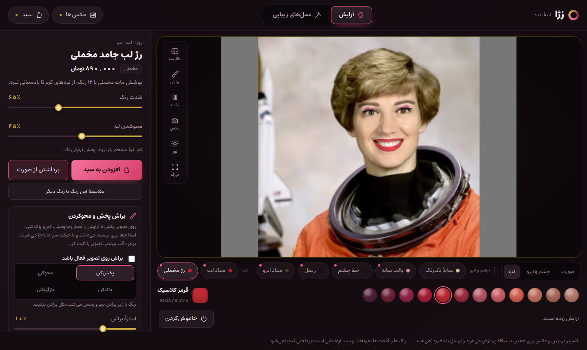
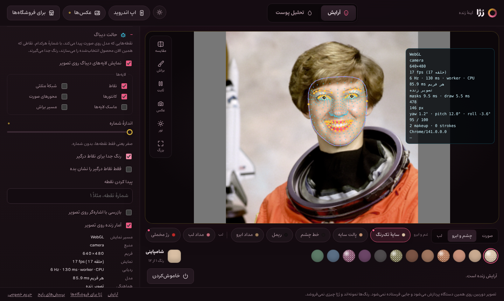

# رُژا · Roja

A live mirror that runs entirely in the browser, made for cosmetics shops to put on their
own sites. Try makeup on your own face before you buy it — foundation matched to your skin, blush, contour, eyeshadow, liner, mascara,
brows and lips — then blend, fade or erase it by hand with a brush, compare two shades
side by side, or check your skin type and get a routine.
Everything happens on the device: the camera frame becomes a GPU texture and is never
uploaded or stored, and no asset is fetched from anywhere but this repository.

**[Open the mirror →](https://pythonpath.ir/)**

> آینه‌ای زنده که کاملاً داخل مرورگر اجرا می‌شود. آرایش را پیش از خرید روی صورت خودت
> امتحان کن، با براش پخش یا محوش کن، دو رنگ را کنار هم ببین، یا نوع پوستت را بشناس.
> تصویر دوربین روی همان دستگاه پردازش می‌شود و هیچ‌جا فرستاده یا ذخیره نمی‌شود.

The interface is in Persian and laid out right-to-left. It is ivory and rose by day and dark by night —
the system's choice, or the switch in the header (kept on the device) — while the mirror
itself is always dark, so the face is the brightest thing on screen. The makeup panel is
three short tabs: the shade's controls, the look on the face with the ready-made looks,
and the brush.

Roja sells nothing itself. A shop puts the mirror on its site (an `iframe` or a link with
`?shop=<id>`), and every "buy" in it leads to that shop's product, or its search for the
product's kind and the shade's colour — or straight into the shop's own cart. Without a
shop, the site is the demo and offers the mirror to shops. See [For shops](#for-shops).

The cosmetic-procedure preview that used to be a third mode here has moved out to become
a product of its own, Roja Clinic, for aesthetic doctors (a separate repository).

| makeup | debug |
|---|---|
|  |  |

---

## This is not a medical tool

Colours are samples on a screen, not measured product matches — ambient light, the camera
and natural skin tone all move what you see.

The skin check is cosmetic guidance, not a diagnosis: it does not look for skin disease,
and its scores describe one camera picture, not a clinical grading.

## What is in it

**آرایش — makeup.** Sixteen kinds of product in sample shades (121 of them), grouped as face,
eyes and lips: matte foundation and a light skin tint, concealer, contour, powder and cream
blush, highlighter, single eyeshadows and four-pan palettes, liquid liner in four shapes
(thin, classic, winged, smudged), mascara (lengthening or volumising), brow pencil, lip
liner, velvet and liquid-matte lipsticks, and gloss that layers over a lipstick. Every
product has intensity (or coverage) and edge-feather controls, a finish (matte, velvet,
satin, cream, gloss, shimmer, metallic, dewy) and a way to the shop the mirror is for.

- **Brush — پخش‌کن، محوکن، پاک‌کن، بازگردانی.** Paint on the mirror to *blend* colour out
  softly, *fade* it a little at a time, *erase* it, or *restore* whatever you changed. Each
  stroke works on all makeup or on the current product only, can be undone, and is pinned
  to the face rather than the screen, so it stays put when you move. Freeze the camera
  frame for precise work.
- **Shade finder.** Reads the colour of your cheeks, forehead and chin for a moment and
  suggests the nearest foundation, skin tint and concealer shades, with an undertone
  estimate. Looks that include a skin product use it automatically.
- **Looks.** Six ready-made combinations (natural, office, evening, smoky, bridal, bold lip)
  in one tap; each product can then be changed on its own. The combination on the face
  can be saved under a name of your own ("my looks", kept on this device), or sent as a
  link: whoever opens it gets the same look on their own face. The look travels in the
  part of the address after `#`, which the browser never sends to the server.
- **Compare.** A seam across the face: with and without makeup, or — after pinning a
  shade — two shades of the same product side by side. "Several shades" takes the face
  in up to four shades of the current product and lays them out in one picture, cut
  around the face, to save or send.
- **Lighting preview.** See the look under window daylight, golden-hour sun, office
  fluorescent light, a warm evening room or a camera flash.
- **Photos.** Use a photo instead of the camera (pick a file or drop it on the mirror), and
  take snapshots of the mirror to compare two of them later, save them, or send them
  through the phone's share sheet (Instagram, Telegram, WhatsApp…) where the browser
  allows it. Snapshots stay in the page's memory until you save or share them.
- **Buy**, in a shop's mirror only: "see it in <shop>" under the product, and "buy" in the
  header lists every product on the face, each a link into the shop. Nothing is paid or
  stored on Roja's side.
- **Remembered** — the look on the face is kept in the browser's local
  storage, so a reload or the next visit starts where the last one stopped.
- **First visit.** When the mirror first comes on, five short notes point at the shades,
  the products, the brush, compare and the snapshot button. Skipped or finished, they do
  not come back.

**تحلیل پوست — skin check.** A picture of the bare face and eleven short questions give a
skin profile: the Fitzpatrick phototype (I–VI, carried by the sunburn-and-tan question, with
skin colour from the camera as a nudge), the Baumann skin type (oily/dry, sensitive/resistant,
pigmented/non-pigmented, wrinkled/tight — 16 types) with a confidence for each letter, and
0–100 scores for oiliness, dryness, sensitivity, redness, spots, uneven tone, lines, texture
and the eye area. Before measuring, the mirror checks the picture — distance, a straight head,
enough and even light, a natural colour of light, focus — and a measure the picture cannot
carry is left out rather than guessed. The profile becomes a morning and evening routine of
kinds of skincare product (in a shop's mirror, each a link into the shop), each step with the reason it is there: at most two night
actives (one for sensitive skin), salicylic acid and a retinoid never on the same night, no
retinoid in pregnancy or when retinoids irritate. It can be done without a picture, from the
answers alone. If you choose to, the result (numbers and answers, never the picture) is kept
on the server so a check weeks later can be compared with it; "do you agree with this
result?" is recorded with it, and everything kept can be deleted from the same screen.

**حالت دیباگ — debug overlay.** Every landmark the model returns, numbered, with the ones
driving the current selection picked out in a second colour. Optional layers: the tracking
mesh, the named contours, the face-local axes every size is measured in, the makeup masks
and the brush strokes. Find a landmark by number,
or point at the mirror to inspect the nearest one. Live stats (renderer, frame size, frame
rate, tracking rate and latency, mask and draw cost, head pose, symmetry, expression
scores) in the panel or on the mirror, and an export of all of it as JSON.

## For shops

`shops.js` lists the shops the mirror can sell for. Each has a name, its own origin, and its
search address (`{q}` becomes the words searched for), and can give its own page per product
or per shade (`links`) and a referral code to add to every link (`params`). Only a shop
listed there can be named in an address, so a link cannot send people anywhere else.

```html
<iframe src="https://pythonpath.ir/?shop=YOUR-SHOP"
        allow="camera; clipboard-write; web-share; fullscreen"
        style="width:100%;height:760px;border:0"></iframe>
```

Inside a shop's page the mirror hides its footer and its own links, and on every "buy" it
posts `{type:'roja:buy', shop, product, shade, query, url}` to the shop's origin only (never a
picture). A shop with `cart: true` listens for it and adds the product to its own cart, and
the mirror stays where it is. `?shop=demo` is a demo shop whose "buy" lands on `business/`,
the page that explains all this to shops. A look sent from a shop's mirror opens in that
shop's mirror.

`stats.html` shows the usage counts for every mirror together, for Roja's own site, or for
one shop's mirror: what was tried, what was opened in the shop, and how far visits got,
from opening the page to opening the shop.

### Plans

A shop's mirror has one of two plans (`plan.js`):

| | basic (free) | professional |
|---|---|---|
| shades | about half of each product's, spread over its whole range | all |
| ready-made looks | the first two | all |
| skin check | profile, the skin's state, priorities | also the morning and evening routine, keeping results and comparing them |
| pictures | Roja's mark, at most 720 px on the long side | the camera's full size, no mark; several shades side by side |
| 3D view | | the face with its makeup as a model to turn |

A shop buys the professional plan itself on `business/`, paying through Zarinpal: it gives
its name, its site's address and, if it likes, its search address, and comes back with its
shop id, the code to put on its site, and an **activation code**. The code opens the shop's
panel on the same page: how long the plan runs, renewing it, and changing the name or
addresses. These shops are kept on the server (`server/billing.mjs`), not in `shops.js`;
the mirror asks the server about an id it does not know (`resolveShop`).

The professional plan opens only on the shop's own site: inside a page of its origin, or
reached by a link from it (and for the rest of that visit). The same address opened
anywhere else is the basic mirror. Roja's own site shows everything, with the
professional parts marked, as the showcase; a shop in `shops.js` can be given
`plan: 'pro'` (the demo shop is). The mirror runs on the shopper's device, so this decides
what is offered rather than locking anything: the agreement with the shop is what binds.

## How it works

- **Face tracking** — MediaPipe Face Landmarker, 478 points with head pose and expression
  scores, running in a Web Worker so the interface never blocks. The model runs on the GPU
  wherever the browser has a real one (not on iPhones, and not where WebGL is only emulated
  in software); otherwise, or if the GPU fails, on the CPU. Each camera frame is measured
  once, as soon as the last result is back, and on the fast path it reaches the worker as a
  `VideoFrame`, with no copy. Where a worker cannot run the model at all (iPhones before
  iOS 17 have no WebGL in workers) the same code, `face-core.js`, runs on the page instead.
  The model and its WebAssembly runtime are served from this repo.
- **In step** — a copy of each frame sent to the tracker is kept, and when its landmarks
  come back that very frame is shown with them, so the makeup sits on the face in the
  picture instead of trailing the live video by a tracking round-trip. The picture then
  moves at the tracker's pace, so this is done only while it keeps up (16 frames a second
  or more); below that the live video is shown with the latest landmarks. Landmarks are
  steadied by a One Euro filter: jitter is smoothed away while the face is still, and the
  smoothing fades out as it moves, so it adds no lag to a turn of the head.
- **Makeup** — each product is a soft mask, painted once in a front-on view of MediaPipe's
  canonical face (`facemesh.js`, read out of the face model by `tools/facemesh.cjs`)
  whenever a product or setting changes. Every frame the face mesh, placed on the live
  landmarks, carries it onto the face: a few hundred triangles on the GPU instead of
  repainting on the CPU each time the face moves, and a mask that bends with a smile or a
  blink. The mesh's triangles across the eye and mouth openings are left out, so colour is
  never stretched over open lips or an open eye. A WebGL pass then recolours the camera
  texture under the mask. The colour is scaled to the light
  on the face and modulated by each pixel's brightness relative to the region's mean, so
  lip creases, shading and skin texture show through it as they do with real product.
  Finish decides how glints behave: matte flattens them, gloss sharpens them, shimmer
  scatters specks. Foundation adds edge-preserving smoothing that stays on skin. Soft edges
  come from a blur built only from `drawImage` scaling (`blur.js`), which every browser
  draws the same way; canvas shadows and filters do not, on iPhones above all. Broad
  masks are painted at half resolution, only the painted part of each is uploaded, and
  every pass is scissored to its layer, so a full look stays cheap. Without WebGL, the same
  masks are painted from the live landmarks in flat colour on a 2D overlay.
- **Brush** — every stroke point is stored as barycentric weights over the three landmarks
  around it, and the strokes are replayed into coverage maps in the face's own space, so a
  stroke stays on the skin where it was drawn however the face moves. A
  stroke is one path, so going over the same spot twice in one stroke does not double it.
- **Before/after** — a second composite drawn through a `gl.scissor` on one side of the
  seam.
- **Skin check** — `skin-scan.js` cuts the face out of the frame at a fixed 320 px ear to ear
  and picks forehead, cheeks, nose, chin, under-eye and eye-corner regions from the
  canonical mesh, drawn through the live landmarks. Each is measured in CIE Lab, in bands of
  detail so the shading of the face's shape is never read as a line or a spot: tone and its
  Individual Typology Angle, shine on the T-zone, redness and red spots, dark spots and
  uneven tone, fine texture, lines. Six frames are combined by median. `skin.js` turns that
  and the answers into the profile and the routine; `skin-panel.js` is the panel.

No build step, no framework, no bundler. Plain ES modules served as files.

**Reading pages** — `makeup/<id>/`, an index of them, `faq/`, `privacy/`, `business/`,
`sitemap.xml` and `robots.txt` are plain HTML made by `tools/build-pages.mjs` from
`catalog.js`, so search engines (and anyone without a camera) can find each product. They
are committed like the rest of the site; run the tool again after changing it
(`tools/deploy.sh` refuses to deploy stale ones). Each page leads into the mirror with that
item chosen, through the address: `#product=velvet`, `#skin`, or `#look=…` for a shared
look. The old procedure pages' addresses (`/procedures/…`) land on the mirror (see
`server/nginx-pythonpath.conf`).

**The 3D view** (`viewer3d.js`, `fuse.js`, `head3d.js`, taken over from Roja Clinic) turns
the face with its makeup as a model, out to 50° each way. It is made from one picture:
the mirror as it is, held still while the view is open, on the tracker's own mesh with
its depth, smoothed and given an atlas of its own. A change of shade or look remakes it
from the same frame; "without makeup" makes it from the bare frame. A snapshot while it
is open saves the model as seen.

## Privacy

The camera frame, or the photo you pick, is processed on the device and never sent or
stored. The only pixels read back are the ones you ask for: a snapshot you take (kept in the
page until you save it or close the page), while the shade finder runs a few small skin
patches that the face worker averages into one colour, and while the skin check measures,
the face cut out of the frame, reduced on the page to a few numbers and let go.

The look you put together and your saved looks are kept in the browser's
own storage on this device and never sent anywhere.

Anonymous usage counts leave the device in batches: which shades and looks
were tried, which product was opened in the shop, how often something was shared, and how
far the visit got (page opened, camera or photo started, face found, a shade tried, the
shop opened) — pairs like `shade vlv-3`, with the id of the shop whose mirror it is. The
server (`server/stats.mjs`) checks each against the catalogue and `shops.js` and keeps
only a total per item per shop per day: no key, cookie, address or time of day, and
nginx keeps no access log for it. Nothing is counted from the Android app or a
development server.

The other thing that can leave the device is a skin check result, and only when you tick the
box and press save: its scores and your answers, no picture, no name or account. A random key
made on your device (kept in its local storage, sent in a request header) names your results
on the server; only a hash of it is stored, and the same screen deletes everything kept
under it.

Shops that buy a plan give their name, their site's address and, if they like, a mobile
number; the server keeps those, how long the plan runs, a hash of the activation code, and
for each payment its amount and Zarinpal's reference and masked card number. Nothing about
the shoppers who use a shop's mirror is part of it.

## Browsers

Chrome, Edge, Firefox and Samsung Internet on Android and desktop; Safari, and Chrome or
Firefox on iPhone and iPad (all WebKit there); Safari on the Mac. The camera needs HTTPS.
Browsers built into other apps (Instagram, Telegram…) often have no camera: the page says
so and suggests opening it in Safari or Chrome, and a photo still works there. When the
camera cannot start, the message names the reason and where to allow it, with an error
code; the debug panel shows the browser, whether tracking runs in a worker or on the page,
and the last error.

## Running it locally

Needs [Node](https://nodejs.org) (only to serve the files — nothing is compiled).

```bash
node tools/preview.cjs      # serves this folder at http://127.0.0.1:4173
```

On Windows you can double-click `run-local.cmd` instead, which starts the server and opens
the browser.

The camera works on `127.0.0.1` and `localhost` because browsers treat them as secure
contexts. It will **not** work over a plain-HTTP LAN address such as `192.168.x.x` — that
needs HTTPS. A photo works anywhere.

Keyboard: **B** brush, **[ ]** brush size, **Ctrl+Z** undo a stroke, **C** compare,
**F** freeze the frame, **S** snapshot.

## Android and installing

- **Android app** — [`android/`](android/README.md) carries this site as its interface, with
  every file inside the APK and no network permission, and does the live mirror natively
  under it: CameraX, MediaPipe on the GPU and an OpenGL ES renderer that compiles this
  site's own shaders. The *Android app* workflow builds the
  APK and runs it on an emulator; each tested build of `main` is published as a release, so
  [`releases/latest/download/roja.apk`](https://github.com/soroushaz1/roja/releases/latest/download/roja.apk)
  always downloads the newest one. The site offers it too: an *Android app* button in the
  header opens a dialog with that link and, on a computer, a QR code of it to scan with
  the phone (`icons/app-qr.svg`, made by `tools/app-qr.py`); on an Android phone a line
  under the start buttons opens the same dialog. It is not offered on an iPhone or inside
  the app.
- **Install from the browser** — the site is also an installable web app
  (`manifest.webmanifest`). Once installed, `sw.js` keeps its files, including the face
  model after the first camera use, so it opens offline. The service worker is not
  registered on `localhost`, so development always serves fresh files.
- **Releasing a change to the site** — raise the `?v=` number on every file that names
  another (`index.html`, the modules, `sw.js`), the service worker's `CACHE`, and the
  release in `<html data-release>` and `RELEASE` in `app.js` together. A browser or the
  service worker can still hold the previous page, so just after a release a kept page can
  be handed the new script; `app.js` sees the release differ and loads the page
  afresh once (then says a new version is on its way rather than fail).

## Server

The site runs at [pythonpath.ir](https://pythonpath.ir/) (204.48.27.227, Ubuntu, nginx), with
`www.` redirected to it. nginx serves the files and passes `/api/skin` to
`server/skin-api.mjs`, a small Node service (no dependencies; `node:sqlite`) that keeps skin
check results and the anonymous usage counts (`/api/stats`); it rebuilds every record
from the fields it allows and stores nothing else.

The counts are read on `stats.html`, with a key set on the server only:

```bash
echo "ROJA_STATS_KEY=$(openssl rand -hex 16)" > /etc/roja-api.env && chmod 600 /etc/roja-api.env
systemctl restart roja-api
```

Without it the counts are still kept, but nobody can read them.

```bash
tools/deploy.sh             # the working copy to the server: site, API, unit, nginx site
```

Every push to `main` that touches the site is deployed by `.github/workflows/deploy.yml`, which
runs the same `tools/deploy.sh` and then checks that pythonpath.ir serves the new release; it
can also be run by hand from the Actions tab. It needs two repository secrets:
`ROJA_DEPLOY_KEY`, a private SSH key made for it alone (its public half in the server's
`/root/.ssh/authorized_keys`), and `ROJA_KNOWN_HOSTS`, the output of `ssh-keyscan 204.48.27.227`,
so the key is only ever offered to this server.

`tools/deploy.sh` runs `tools/skin-check.mjs` first, then puts the site in
`/var/www/pythonpath` and the API in `/opt/roja-api` (each swapped in whole), installs
`server/roja-api.service` (its own throwaway user, writing only `/var/lib/roja-api`) and
`server/nginx-pythonpath.conf`, and reloads both. The certificate is Let's Encrypt's, set up
once with `certbot certonly --webroot -w /var/www/pythonpath -d pythonpath.ir -d www.pythonpath.ir`
and renewed the same way.

This server is temporary; the site is meant to move to a server in Iran. If it is ever put
behind Cloudflare's proxy, the nginx site already reads the visitor's address from
`CF-Connecting-IP` for Cloudflare's ranges only, so the API's rate limit stays per visitor.

### Payments

`server/billing.mjs` sells the professional plan (see [Plans](#plans)) through Zarinpal's
v4 gateway: `/api/plans` gives the prices, `/api/pay/start` asks Zarinpal for a payment and
returns the address to pay at, `/api/pay/back` is where Zarinpal sends the payer back
(verified there, then on to `business/` with the activation code or the news), and
`/api/shop/login`, `/api/shop/update` and `/api/shop` serve the shop's panel and the
mirror. Activation codes are kept only as hashes; a new one is shown for an hour after
paying should the page be opened again, then only its hash is left. Amounts go to
Zarinpal in rials; prices are set in toman.

It reads, from `/etc/roja-api.env`:

- `ZARINPAL_MERCHANT`: the merchant id. Without it, payment is closed and `business/` says
  to get in touch instead. Never in the repository: the deploy workflow writes it from the
  repository secret `ZARINPAL_MERCHANT`.
- `ZARINPAL_SANDBOX=1`: every payment goes to Zarinpal's sandbox, where nothing is charged.
- `ROJA_PRICE_MONTH`, `ROJA_PRICE_YEAR`: the prices in toman (990000 and 9900000 if unset).

The last three come from repository variables of the same names; whatever is not set is
left as the server has it. Zarinpal checks that the payment's return address is on the
site registered for the merchant id, so that site must be `pythonpath.ir`.

## Tests

```bash
node tools/preview.cjs       # in one terminal
node tools/roja-check.cjs    # in another
```

A Playwright run against a simulated camera. It checks that a bare face reproduces the
camera frame pixel-exactly; that every product colours the
face without touching the eye openings or anything off the face; that a red reads as red and
the finish and texture controls change the result; that the brush erases, fades, restores
and blends — and that an erased area follows the face when it moves; both compare modes;
every look, the shade finder, the lighting preview and snapshots; that the compare seam
sits on the cut it draws; that losing the face leaves
nothing stale on screen; every debug layer, the landmark search, the stats and the export;
that the mirror never resizes when the panel's content changes; that the phone layout keeps
the mirror and its controls on one screen; that a photo opens the right way round after a
camera session; that a device without WebGL still gets working makeup; and that an
iPhone-like browser — a worker that cannot run the tracker, a `video.play()` refused until
a tap — still tracks the face on the page, offers a tap to start the picture, never hides the
camera video, and shows makeup. It checks where the Android app is offered — with the QR
code on a computer, under the start buttons and fitting the start box on an Android phone,
nowhere on an iPhone or inside the app — and that the download points at the latest
release. A page from an older release handed the new script must be loaded afresh once,
and one that stays old must show a note instead of looping or failing. Last, it runs the model on the GPU with frames handed over
as `VideoFrame`s, and on the CPU route iPhones take, each with frames shown in step with
their landmarks: the picture must equal the camera's and makeup must appear. Point it at a
deployed copy with `ROJA_URL`. Playwright is found through `PLAYWRIGHT_MODULE`, a normal
`require` or the global npm folder, and the browser through `ROJA_CHROMIUM`, an installed
Chrome or Playwright's own Chromium.

`node tools/skin-check.mjs` checks the skin check without a browser: that the Baumann
letters follow the answers and the picture moves an axis without overruling a clear answer,
that confidence rises when the two agree, that Fitzpatrick follows the sun answer, that a
picture too small or blurred adds no detail scores and one in coloured light no colour ones,
that the routine keeps its safety rules (no retinoid in pregnancy or when retinoids irritate,
one active for sensitive skin, salicylic acid and a retinoid on different nights); and, against
a throwaway database, that the server keeps a result under its key only, refuses anything
outside the record's shape, records feedback on the owner's result only and deletes all of a
key's results and no other's.

`node tools/roja-perf.cjs` prints the app's own numbers (pictures and tracked frames a
second, tracking latency, the model's time per frame, mask and draw cost) for a few looks.
Headless Chromium only emulates a GPU, so compare runs with each other; on a phone, open the
debug panel for the same numbers. `?gpu=0` keeps the model on the CPU and `?gpu=force` puts
it on the GPU regardless, for comparing the two.

`node tools/billing-check.mjs` runs the shops' payments end to end against a throwaway
database and a stand-in for Zarinpal on the same machine: checking what a shop sends,
paying, the way back opened twice, cancelled and refused payments, the panel, renewing,
and the usage counts taking a new shop. `tools/deploy.sh` runs it before deploying. To try
the business page by hand, run the API with `ZARINPAL_SANDBOX=1` and a merchant id, and
the preview with `ROJA_API=http://127.0.0.1:51840 node tools/preview.cjs`, which passes
`/api/` on as nginx does.

## First load

About 15 MB, mostly the face model and its WebAssembly runtime, then cached. While they
come down, the mirror shows how far along they are. That is the
cost of doing the tracking on the device instead of sending the camera somewhere.

## Licence

The code here is MIT — see [LICENSE](LICENSE). Bundled third-party assets keep their own
licences; see [THIRD-PARTY.md](THIRD-PARTY.md).
